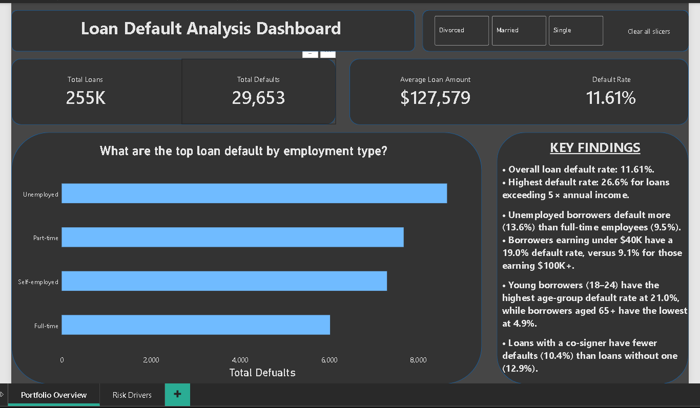
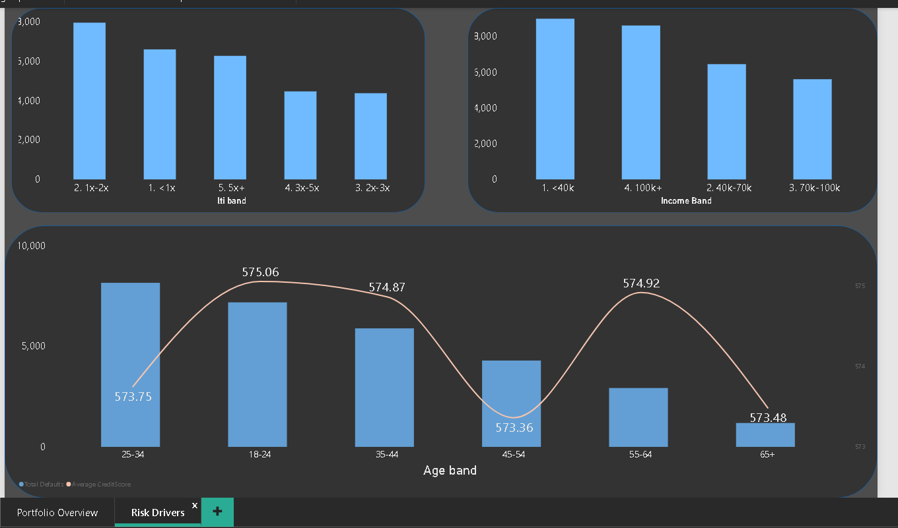
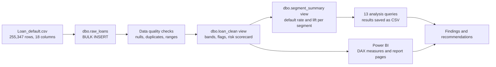
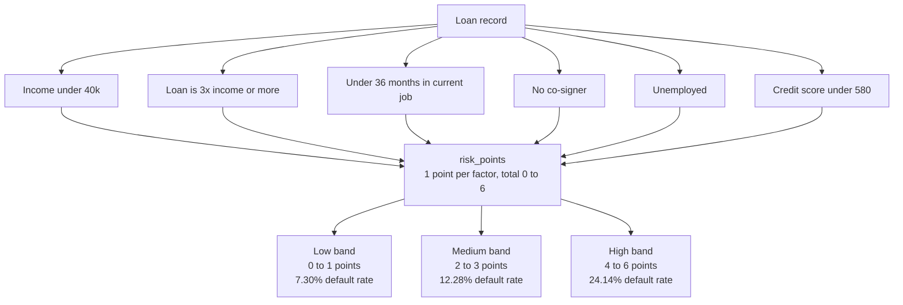

# Loan Default Risk Analysis (SQL Server + Power BI)


Which customers are most likely to default on a loan, and what should the bank change in approval or pricing?

This project analyses **255,347 loan records** in SQL Server, builds a simple **risk scorecard** using SQL only, and presents the results in a Power BI dashboard.

## At a glance

| | |
|---|---|
| **Business question** | Which borrower and loan characteristics are linked to default, and where should the bank tighten its rules? |
| **Data** | 255,347 loans, 18 columns (Kaggle: Loan Default Prediction Dataset) |
| **Tools** | SQL Server (T-SQL: CTEs, window functions, views), Power BI (DAX) |
| **Headline result** | 11.61% of loans default. Loans above 5x income default at **26.6%**, and the 10% of loans with the highest risk score produce **21% of all defaults** |

## Dashboard

The Power BI file is in [`powerbi/loan_default_dashboard.pbix`](powerbi/loan_default_dashboard.pbix). Measures and page details are documented in [`powerbi/README.md`](powerbi/README.md).

**Page 1: Portfolio overview**



**Page 2: Risk drivers**



## Project workflow



## Key findings

Overall: **29,653 of 255,347 loans defaulted (11.61%)**. By loan value, 13.15% of the money lent is in defaulted loans, so larger loans default more often.

**1. Loan size relative to income is the strongest signal.**

| Loan-to-income | Loans | Default rate |
|---|---|---|
| Under 1x | 80,675 | 8.18% |
| 1x to 2x | 81,249 | 9.79% |
| 2x to 3x | 39,056 | 11.20% |
| 3x to 5x | 30,756 | 14.52% |
| **5x and above** | 23,611 | **26.55%** |

**2. Which factors separate defaulters best** (gap in default rate between the riskiest and safest segment):

| Factor | Safest segment | Riskiest segment | Gap (pts) |
|---|---|---|---|
| Loan-to-income | 8.18% (under 1x) | 26.55% (5x+) | 18.4 |
| Age | 4.85% (65+) | 21.03% (18-24) | 16.2 |
| Interest rate | 6.61% (under 8%) | 17.82% (20%+) | 11.2 |
| Income | 9.10% (100k+) | 19.03% (under 40k) | 9.9 |
| Job tenure | 8.95% (5+ years) | 16.97% (under 1 year) | 8.0 |
| Loan amount | 8.06% (under 50k) | 15.79% (200k+) | 7.7 |
| Employment type | 9.46% (full-time) | 13.55% (unemployed) | 4.1 |
| Co-signer | 10.36% (yes) | 12.87% (no) | 2.5 |
| Credit score band | 10.18% (740+) | 12.47% (under 580) | 2.3 |
| DTI band | 10.36% (under 0.2) | 12.23% (0.6+) | 1.9 |
| Loan term | 11.57% | 11.70% | 0.1 |

Credit score and DTI separate defaulters only weakly in this data, and loan term makes no difference.

**3. A co-signer lowers default risk in every employment group.** Unemployed with no co-signer: 15.06%. Full-time with a co-signer: 8.47%.

**4. Simple risk scorecard (SQL).** One point for each of: income under 40k, loan above 3x income, under 3 years in the job, no co-signer, unemployed, credit score under 580.

| Risk points | Loans | Default rate |
|---|---|---|
| 0 | 23,832 | 6.17% |
| 1 | 72,181 | 7.68% |
| 2 | 82,787 | 10.54% |
| 3 | 50,621 | 15.13% |
| 4 | 20,057 | 22.21% |
| 5 | 5,287 | 29.94% |
| 6 | 582 | 37.80% |

The default rate rises with every extra point. The **High band (4 to 6 points) is 10.2% of loans but 21.1% of defaults**, with a 24.14% default rate (2.1x the portfolio average). The Low band (0 to 1 point) is 37.6% of loans with a 7.30% default rate. Age and marital status are not used in the scorecard.



## Recommendations

1. **Tighten rules above 3x income.** Loans at 3x income or more default at 19.7% (54,367 loans). Require extra verification above 3x, and a co-signer or manual approval above 5x.
2. **Ask for a co-signer on riskier profiles** (unemployed, under 1 year in the job, income under 40k). The co-signer gap is about 2 to 3 points in every employment group.
3. **Verify income and employment more carefully.** Borrowers under 40k income default at 19.0% and those with under 1 year in the job at 17.0%.
4. **Use the scorecard to monitor and review the portfolio.** The High band is the first place to look for early warning and pricing review.
5. **Do not rely on credit score alone.** It separates defaulters weakly here, so combine it with loan-to-income, income and tenure.
6. **Treat interest rate with care.** Borrowers at 20%+ default most (17.82%), but banks usually set higher rates for riskier borrowers, so this does not show that higher rates cause defaults.
7. **Age and marital status are shown for analysis only.** Young borrowers default most (21.03% at 18-24), but using age or marital status for approval decisions is unfair and can be illegal.

## Skills demonstrated

- **SQL Server (T-SQL):** table design, `BULK INSERT`, CTEs, views, `CASE` banding, window functions (`RANK`, running totals, share of total), `UNION ALL`, data quality checks.
- **Analytics:** default rate and risk lift by segment, risk matrices, a rule-based risk scorecard, and business recommendations.
- **Power BI:** data model on a SQL Server view, DAX measures, slicers, and report layout.
- **Documentation:** data dictionary, reproducible run order, and an honest limitations section.

## Repository structure

```text
.
├── sql/
│   ├── 01_create_database_and_table.sql
│   ├── 02_load_data.sql
│   ├── 03_data_quality_checks.sql
│   ├── 04_create_clean_view.sql          (bands, flags, risk scorecard)
│   ├── 05_create_segment_summary_view.sql
│   ├── 06_analysis_queries.sql           (13 analysis queries)
│   └── results/                          (query outputs as CSV)
├── powerbi/
│   ├── loan_default_dashboard.pbix
│   ├── README.md                         (measures and page details)
│   └── screenshots/
├── docs/
│   └── data_dictionary.md
├── data/
│   └── README.md                         (how to get the dataset)
├── LICENSE
└── README.md
```

## How to run

1. Download `Loan_default.csv` from Kaggle (see [`data/README.md`](data/README.md)). The file is not stored in this repository.
2. In SSMS, run the scripts in `sql/` in order, 01 to 06. Before running `02_load_data.sql`, change the file path inside it.
3. Check the load: **255,347 rows** and an **11.61%** default rate.
4. Open `powerbi/loan_default_dashboard.pbix` in Power BI Desktop. The data is already imported. To refresh it from your own server, go to **Transform data → Data source settings** and point it to your SQL Server and the `LoanDefault` database.

## Data quality

The file has no NULLs, no duplicate `LoanID`, no extra spaces and no values out of range. Rows with impossible combinations are **flagged, not deleted**:

| Check | Rows |
|---|---|
| Months employed is longer than the borrower's working life (`tenure_flag`) | 26,646 (10.4%) |
| Unemployed but with months employed above 0 | 63,292 |
| Age 22 or younger with a PhD | 6,026 |
| Loan above 5x income (`high_lti_flag`) | 23,610 |

## Limitations

- **The data looks synthetic.** Every category has almost exactly the same number of rows (about 25% each for education and employment type), and several combinations are impossible. Findings describe this dataset, not real bank customers.
- The scorecard thresholds were chosen from the same data and were **not tested on a separate hold-out set**.
- No date column, so no trend over time is possible.
- Currency and country are not stated in the source data. The dashboard shows a $ sign for display only.
- Differences between groups show association, not cause.
- Only 11.6% of loans default, so look at default rates and not at raw counts.

## Credits

Dataset: [Loan Default Prediction Dataset](https://www.kaggle.com/datasets/nikhil1e9/loan-default) on Kaggle (nikhil1e9), taken from Coursera's [Loan Default Prediction Challenge](https://www.coursera.org/projects/data-science-coding-challenge-loan-default-prediction). The SQL scripts, analysis, risk scorecard and dashboard in this repository are my own work.

## Author

**Shakti** · [GitHub](https://github.com/shakti-data) · [LinkedIn](https://www.linkedin.com/in/shaktidata)
